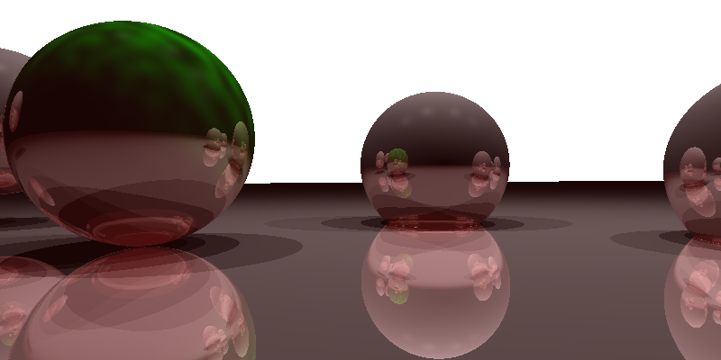
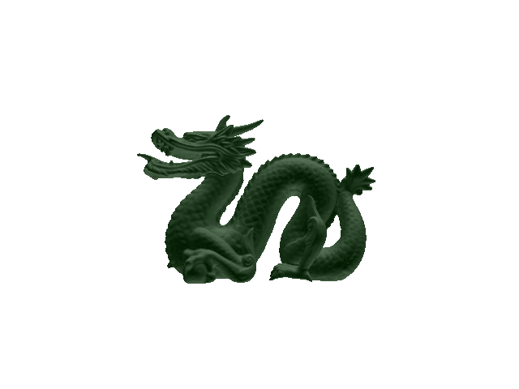
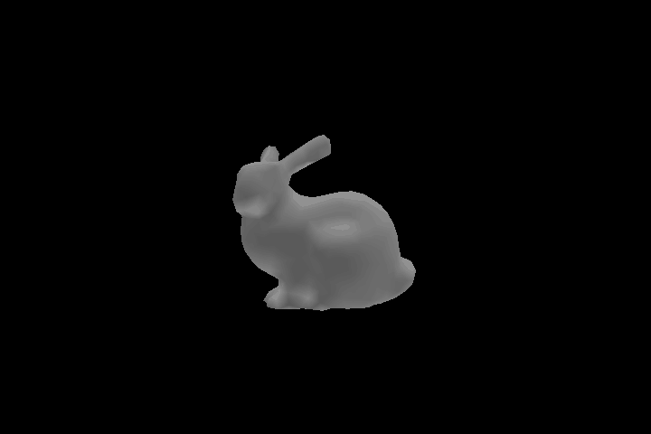

[](https://isocpp.org/)
[](https://cmake.org/)

# Graphics From Scratch

Five small C++ renderers, each building on the last: 2D computational geometry, a ray tracer, a recursive ray tracer with shadows/reflection/refraction, a BVH-accelerated mesh ray tracer, and a full software rasterization pipeline with animated output.

| Stage | What it renders |
|---|---|
| [`geometry/`](geometry/) | Point-in-polygon tests via ray casting |
| [`raytracer/`](raytracer/) | Spheres and planes, orthographic/perspective, Blinn-Phong shading |
| [`raytracer-advanced/`](raytracer-advanced/) | Shadows, reflection, refraction, procedural Perlin-noise texturing |
| [`bvh-mesh-renderer/`](bvh-mesh-renderer/) | Triangle meshes accelerated with a bounding-volume hierarchy |
| [`rasterizer/`](rasterizer/) | A from-scratch vertex/fragment shader pipeline with a software z-buffer, exported as rotating GIFs |

## Sample output

<table>
<tr>
<td><br>recursive ray tracer</td>
<td><br>BVH mesh renderer</td>
<td><br>rasterizer (per-vertex shading)</td>
</tr>
</table>

More renders, including wireframe and flat-shading GIFs, are in each stage's `renders/` folder linked above.

## Stack

C++11, [Eigen](https://gitlab.com/libeigen/eigen) for linear algebra, [stb_image_write](https://github.com/nothings/stb) for PNG export, [gif-h](https://github.com/charlietangora/gif-h) for animated GIF export. Each stage is a standalone CMake project; none of the three libraries are vendored in this repo — CMake's `FetchContent` downloads them at configure time.

## Building

Each stage builds the same way:

```bash
cd <stage>/
cmake -S . -B build
cmake --build build
cd build && ./<stage-name>
```

The first configure downloads Eigen/stb/gif-h and takes 15-30s; after that it's cached.

**Verified:** all five stages configure, build, and run correctly (build tools: CMake 3.31, GCC 6.3). On some older GCC/MinGW builds, Eigen's fixed-size vectorized types trigger a stack-alignment assertion — if you hit `eigen_unaligned_array_assert_workaround`, add `-DCMAKE_CXX_FLAGS=-DEIGEN_DONT_VECTORIZE` to the `cmake -S . -B build` step. This isn't needed on MSVC, Linux GCC/Clang, or modern MinGW-w64.

## Note on the renders

The `renders/` folders here are actual output from running each program locally (verified during setup, not copied from anywhere) — none of it is a course-provided reference image.

## 🎓 Project Context

Built as part of **CSC 305: Introduction to Computer Graphics** at the University of
Victoria (Summer 2025).

## ⚠️ Academic Integrity Notice

This repository is maintained for portfolio and educational purposes only. If you are
currently enrolled in CSC 305 at the University of Victoria or a similar computer
graphics course, please note that using this code in your own assignments may
constitute a violation of Academic Integrity policies.
