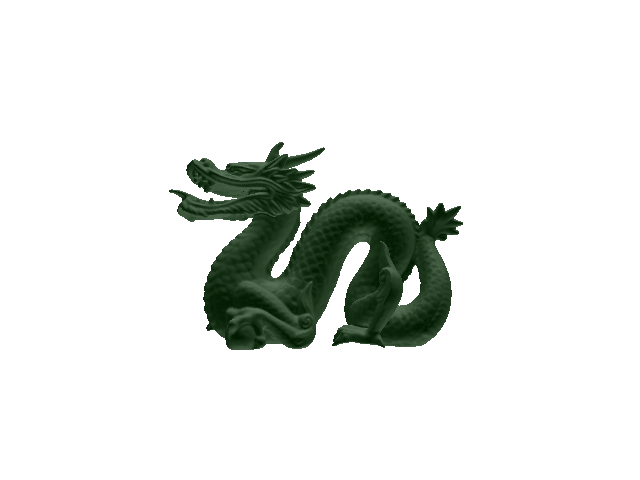

# BVH Mesh Renderer

Ray tracing extended to triangle meshes, accelerated with a bounding-volume hierarchy (BVH) instead of testing every triangle per ray.

## What it does

Loads a triangle mesh (OFF format), builds a binary AABB tree over it by recursively splitting triangles along the longest axis of their centroid bounding box, and ray-traces the mesh by descending the tree instead of doing an O(n) scan over every triangle per ray.

## Stack

C++11, Eigen, stb_image_write for PNG export.

## Build & run

```bash
cmake -S . -B build
cmake --build build
cd build && ./bvh-mesh-renderer
```

Ships with `data/bunny.off` (the Stanford bunny, ~5K triangles) as the default mesh, plus `cube.off` and `dodeca.off`. To reproduce the dragon render below, point `mesh_filename` in `src/main.cpp` at a copy of the Stanford dragon mesh (~100K triangles — not included here to keep the repo small).

**Verified:** builds and runs cleanly against the shipped bunny mesh.

## Output

Rendered against the Stanford dragon mesh (~100K triangles):


