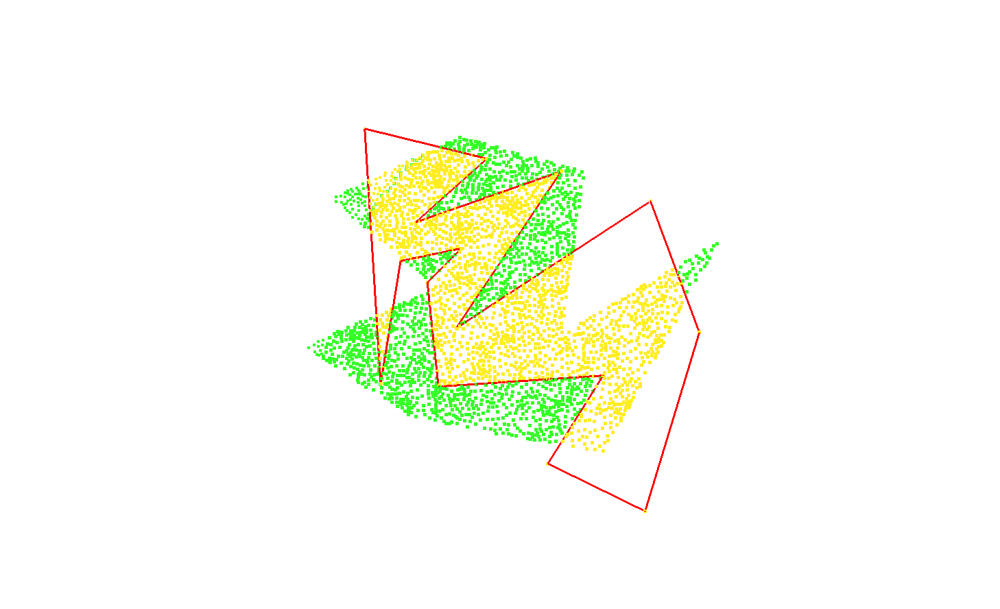

# Geometry

2D computational geometry warm-up: point-in-polygon classification via ray casting, plus point/polygon file I/O.

## What it does

Reads a set of query points (`data/points.xyz`) and a polygon (`data/polygon.obj`), classifies each point as inside or outside the polygon using ray casting with a segment-intersection test, and writes the classified points to `output.xyz`.

## Stack

C++11, Eigen (vector/matrix math only — no rendering).

## Build & run

```bash
cmake -S . -B build
cmake --build build
cd build && ./geometry
```

**Verified:** builds and runs cleanly, produces `output.xyz` from the shipped `data/` fixtures.

## Sample output


