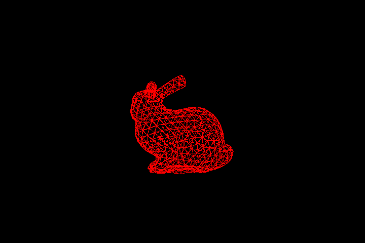
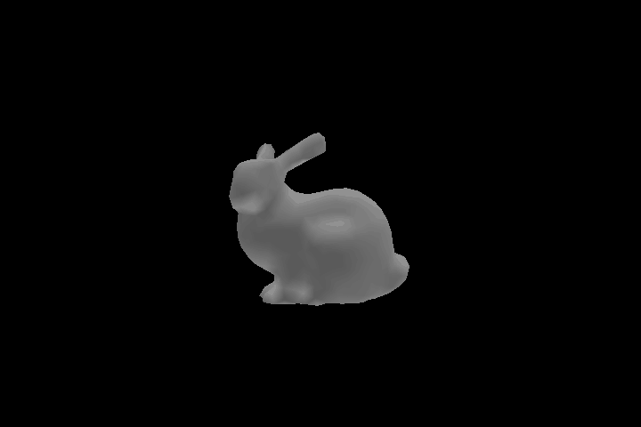

# Rasterizer

A software rasterization pipeline built from scratch: vertex/fragment/blending shaders, a z-buffer, and three render modes with animated output.

## What it does

Implements the core of a graphics pipeline without any GPU API: a programmable `Program` with vertex, fragment, and blending shader stages; camera/projection matrix construction (orthographic and perspective); triangle and line rasterization; per-pixel depth testing against a z-buffer; and per-vertex Blinn-Phong lighting. Three render modes share the same pipeline — wireframe, flat shading (one normal per face), and per-vertex shading (averaged vertex normals) — and each is also rendered as a 360-frame rotating GIF.

## Stack

C++11, Eigen, stb_image_write for PNG export, gif-h for GIF export.

## Build & run

```bash
cmake -S . -B build
cmake --build build
cd build && ./rasterizer
```

Produces `simple.png`, `wireframe.png`, `flat_shading.png`, `pv_shading.png`, and three rotating GIFs (~360 frames each) in the working directory.

**Verified:** builds and runs cleanly end-to-end, producing all seven outputs below. (On some older GCC/MinGW builds, Eigen's fixed-size vectorized types hit a stack-alignment assertion — see the [parent README](../README.md#building) for the one-flag workaround. MSVC and modern GCC/Clang are unaffected.)

## Output

| Wireframe | Flat shading | Per-vertex shading |
|---|---|---|
|  |  |  |
