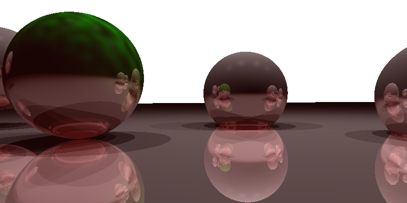

# Recursive Ray Tracer

A recursive ray tracer built on top of the basic one: shadows, reflection, refraction, and a procedural Perlin-noise texture.

## What it does

Extends single-bounce ray tracing to recursive tracing — rays spawn reflection and refraction rays on hit, up to a fixed recursion depth, with shadow rays checked against every light before shading. One surface is textured procedurally with Perlin noise rather than an image.

## Stack

C++11, Eigen, stb_image_write for PNG export.

## Build & run

```bash
cmake -S . -B build
cmake --build build
cd build && ./raytracer-advanced
```

**Verified:** builds and runs cleanly, producing the image below.

## Output


