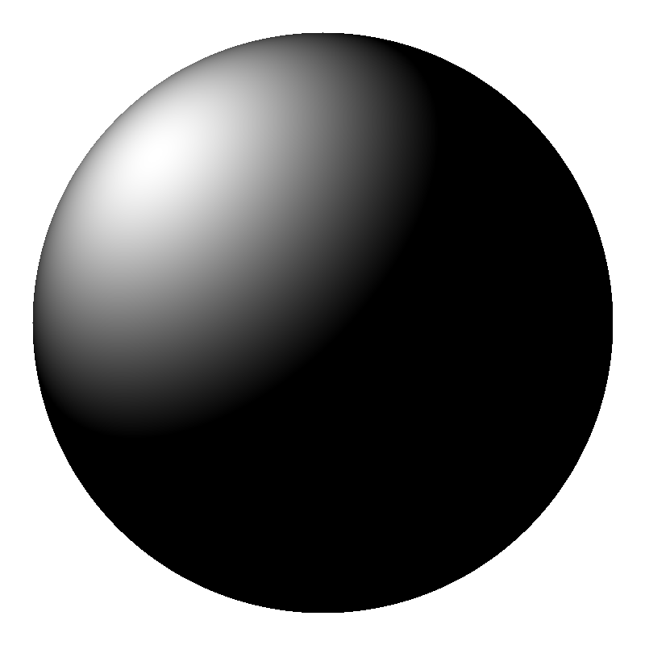
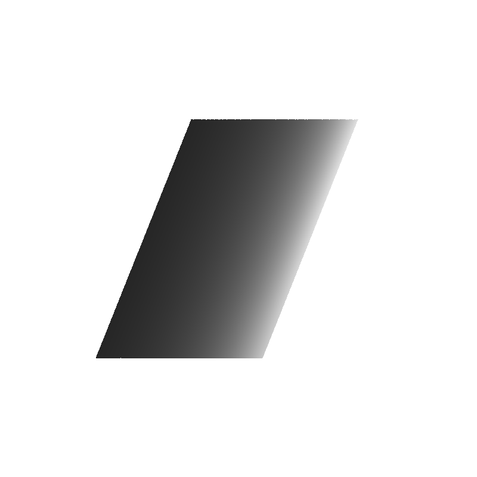
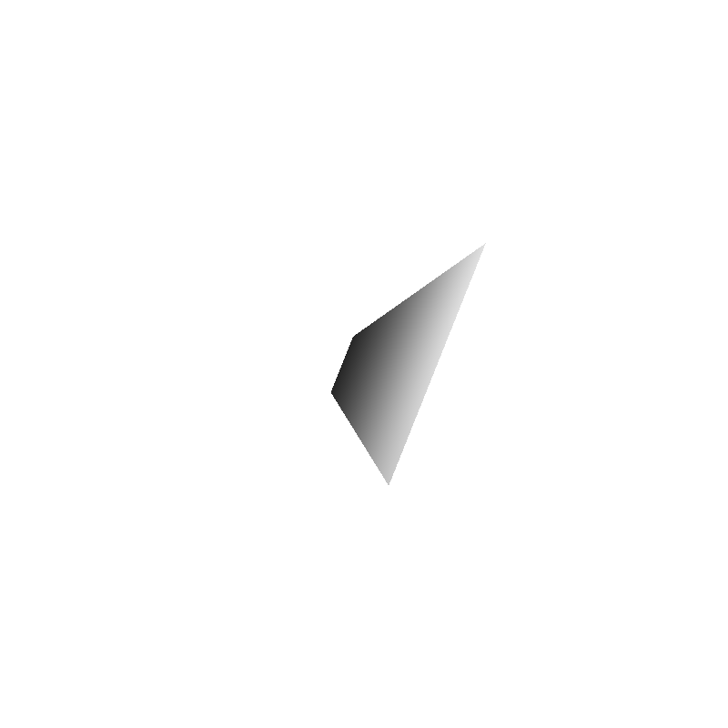
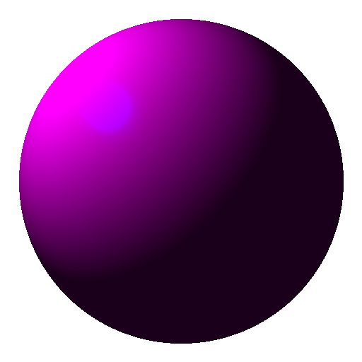

# Ray Tracer

A basic ray tracer: orthographic and perspective cameras, ray-sphere and ray-parallelogram intersection, and Blinn-Phong (diffuse + specular) shading.

## What it does

Casts one ray per pixel from either an orthographic or a perspective camera, intersects it against a sphere or a parallelogram using the appropriate closed-form solve for each shape, and shades the hit point with ambient + diffuse + specular lighting.

## Stack

C++11, Eigen, stb_image_write for PNG export.

## Build & run

```bash
cmake -S . -B build
cmake --build build
cd build && ./raytracer
```

**Verified:** builds and runs cleanly, producing all four images below.

## Output

| Sphere, orthographic | Parallelogram, orthographic | Parallelogram, perspective | Shading comparison |
|---|---|---|---|
|  |  |  |  |
